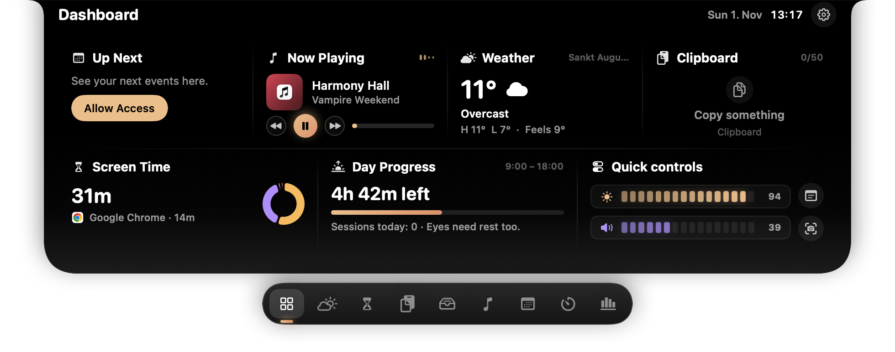
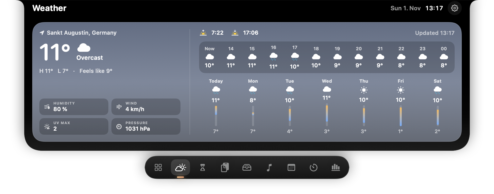
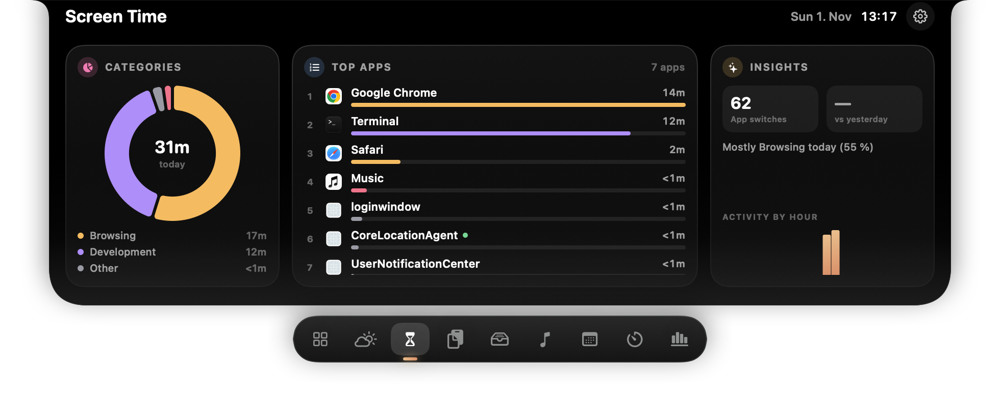
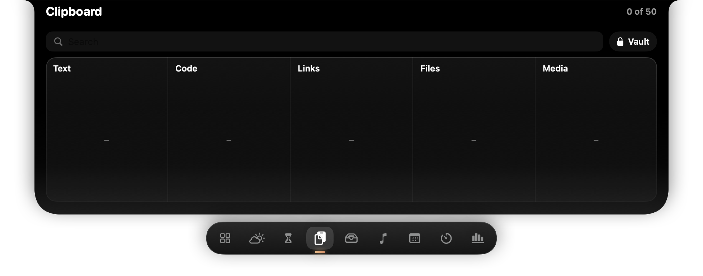
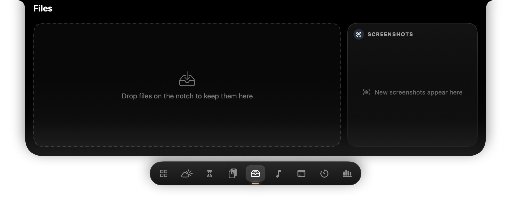
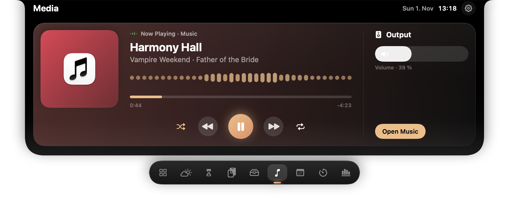
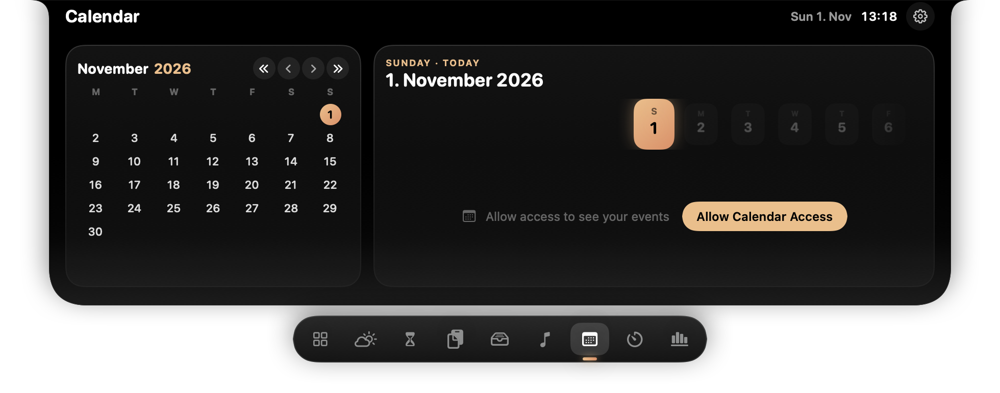
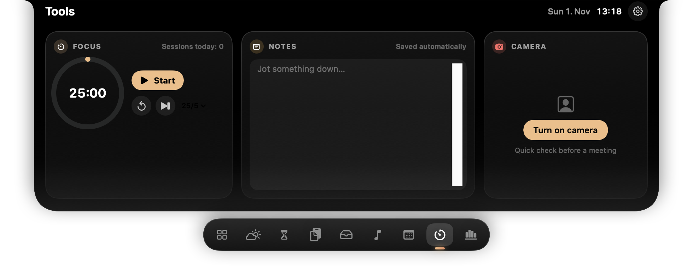

HaloNotch – README - Version: 0.2 - 10 2026

# HaloNotch

A notch hub for the MacBook. Hover over the notch → it expands with four tabs:

| Tab | What it does |
|---|---|
| **Clipboard** | Last 10 copied items (text + images). Click = copy back to clipboard, then ⌘V. ✕ on hover removes an item. |
| **Files** | Drag files onto the notch to park them (references only, nothing is copied). Drag them out again, double-click to open, AirDrop single files or all, right-click for more. |
| **Media** | Now playing from Spotify or Apple Music with previous / play-pause / next. |
| **Calendar** | Your events for the rest of today and tomorrow. |

Plus a **volume / brightness HUD**: when the volume or the built-in display brightness changes, the notch briefly widens and shows a level bar.

**Windows (preview):** a port lives in [`desktop/`](desktop/README.md) – same tabs, built with .NET + Avalonia.

## Screenshots

| | |
|---|---|
|  |  |
|  |  |
|  |  |
|  |  |

## Install (app is not notarized)

HaloNotch is not signed with an Apple Developer ID, so macOS warns on first launch. Two ways to use it:

**Option 1 – build from source (no warning)**

```bash
xcode-select --install          # once, if Xcode is not installed
git clone https://github.com/abinsabu2/HaloNotch.git
cd HaloNotch
./build.sh
open build/HaloNotch.app
```

Apps built on your own Mac are not quarantined, so Gatekeeper does not block them.

**Option 2 – download the prebuilt zip**

1. Download `HaloNotch-<version>.zip` from [Releases](https://github.com/abinsabu2/HaloNotch/releases), unzip, move `HaloNotch.app` to `/Applications`.
2. Open it. macOS shows *"Apple could not verify HaloNotch…"* → click **Done**.
3. Go to **System Settings → Privacy & Security**, scroll down, click **Open Anyway** and confirm. (On macOS 15+ right-click → Open no longer bypasses the warning.)

   Or in Terminal:
   ```bash
   xattr -dr com.apple.quarantine /Applications/HaloNotch.app
   ```

Note: because the build is only ad-hoc signed, macOS may ask for permissions again after each update.

## Build & run

Requires macOS 14+ (target: macOS 26 Tahoe) and Xcode or the Command Line Tools.

```bash
cd ~/Sites/HaloNotch
./build.sh
open build/HaloNotch.app
```

Always start the app via `build/HaloNotch.app` – the Calendar and Automation prompts need the Info.plist that only the app bundle contains.

## Permissions (asked on first use)

| Permission | Needed for | Where to change |
|---|---|---|
| Paste from Other Apps | Clipboard history | Privacy & Security → Paste from Other Apps |
| Automation (Music / Spotify) | Media tab | Privacy & Security → Automation |
| Calendars (full access) | Calendar tab – click "Allow Calendar Access" | Privacy & Security → Calendars |

The app is only ad-hoc signed. After a rebuild macOS may ask for these permissions again.

## Menu bar

Clear Clipboard History · Clear File Tray · Show Volume HUD (on/off) · Show Brightness HUD (on/off) · Quit

## Privacy

- **Clipboard history** stays in memory. Pinned texts are stored in the login keychain. Copies marked as concealed (password managers) are never stored.
- **Vault** (Clipboard → Vault): secrets are encrypted with your PIN or password (PBKDF2-SHA256 + AES-GCM) in `~/Library/Application Support/HaloNotch/vault.json`. It locks after 5 min, on sleep and on screen lock. Copied secrets are cleared from the clipboard after 30 s. A forgotten PIN cannot be recovered; the vault can only be erased.
- **Weather**: your approximate location (rounded to about 1 km) or the city you type is sent to [Open-Meteo.com](https://open-meteo.com) to get the forecast. Nothing else leaves the Mac.
- **Usage tab**: reads Claude Code / Codex session logs only after you enable it. Only token counts are kept.
- The notch panel is excluded from screen sharing and screen recordings.

## Known limitations

- History and file tray are kept in memory only (cleared on quit).
- Media: only Spotify and Apple Music (AppleScript). No artwork yet. Browser audio is not shown.
- HUD: the system's own volume/brightness overlay is still shown as well (hiding it is not supported by macOS).
- Brightness uses the private DisplayServices API – it may stop working with a macOS update; it is then disabled automatically. Auto-brightness changes can also trigger the HUD – switch it off in the menu bar if that bothers you.
- Not suitable for the Mac App Store (private API).

---

Author: Abin Sabu (based on [Tenfold](https://github.com/sivaprasad1988/Tenfold) by Siva, MIT License)
